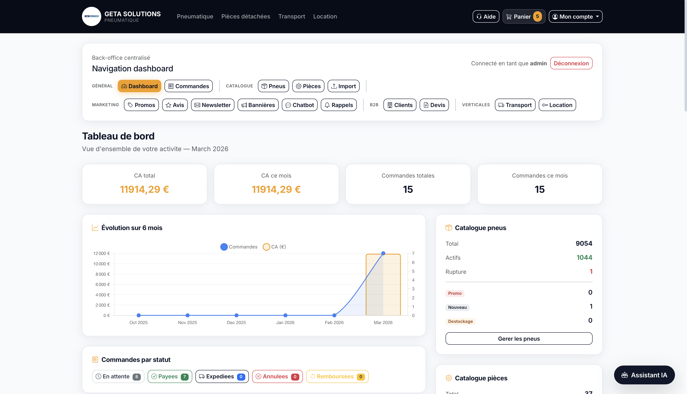

# GETA Solutions — E-commerce Platform


**[getasolutions.fr](https://getasolutions.fr)** — Plateforme e-commerce B2C/B2B spécialisée dans les pneumatiques utilitaires et poids lourds, avec extension multi-verticale (pièces détachées, transport, location).

Projet conçu, développé et déployé en solo — du design à la mise en production.


---

## Stack technique

| Couche | Technologies |
|---|---|
| **Backend** | Python 3.12, Django 5.2 |
| **Base de données** | PostgreSQL 16 |
| **Paiements** | Stripe (Checkout Sessions, Webhooks, mode test/live) |
| **Frontend** | Bootstrap 5.3, CSS custom (~3000 lignes), JavaScript vanilla |
| **Infrastructure** | Ubuntu Server, Nginx, Gunicorn, WhiteNoise |
| **CI/CD** | GitHub Actions (tests automatiques sur push/PR) |
| **Conteneurisation** | Docker + docker-compose |
| **Monitoring** | Sentry |

---

## Fonctionnalités principales

### Catalogue & recherche
- Catalogue pneumatiques avec filtres avancés (dimensions, marque, saison, type de véhicule)
- Recherche rapide multi-critères
- Pages marques avec SEO dédié

### Panier & checkout
- Panier unifié cross-verticale (pneus + pièces détachées dans le même panier)
- Tunnel de paiement Stripe sécurisé avec gestion atomique des transactions
- Calcul de frais de port différencié selon le type de produit

### Espace client
- Inscription / connexion avec protection brute-force (django-axes)
- Historique des commandes et suivi de statut
- Système d'avis produits
- Liste de favoris et alertes de stock

### B2B
- Profils professionnels avec remises personnalisées
- Génération de devis PDF
- Workflow devis → commande

### Pièces détachées (catalogue TecDoc)
- Intégration API TecDoc / TecAlliance en temps réel
- Recherche par plaque d'immatriculation (VRM lookup)
- Catalogue pièces PL et utilitaires
- Système de devis pièce

### Transport & Location
- Catalogue de services et flotte de véhicules
- Formulaires de devis avec workflow complet (devis → acceptation → paiement par virement)
- Emails transactionnels à chaque étape

### Dashboard administration
- KPIs en temps réel (CA, commandes, taux de conversion)
- Gestion commandes, produits, profils B2B
- Import catalogue CSV/XLS
- Système de rappels (paniers abandonnés, devis expirants) avec validation admin
- Permissions granulaires par rôle



### SEO & marketing
- Sitemap XML paginée avec images produits
- Google Merchant Feed (RSS 2.0)
- JSON-LD structured data (AutoPartsStore, Product, Article)
- Open Graph + Twitter Cards
- Blog intégré avec SEO (JSON-LD Article)
- Bannière cookies RGPD

### Chatbot intelligent
- Agent conversationnel RAG (Retrieval-Augmented Generation)
- Base de connaissances indexée (produits + FAQ)
- Assistance client automatisée

### Facturation
- Génération automatique de factures PDF (xhtml2pdf)
- Numérotation conforme
- Envoi par email

---

## Architecture

```
┌─────────────────────────────────────────────────┐
│                   Nginx (reverse proxy)         │
└──────────────────────┬──────────────────────────┘
                       │
┌──────────────────────▼──────────────────────────┐
│              Gunicorn (WSGI)                     │
└──────────────────────┬──────────────────────────┘
                       │
┌──────────────────────▼──────────────────────────┐
│                 Django 5.2                        │
│                                                  │
│  ┌──────────┐ ┌───────────────┐ ┌────────────┐  │
│  │ Boutique │ │    Pièces     │ │ Transport  │  │
│  │ (Pneus)  │ │  détachées    │ │ & Location │  │
│  └────┬─────┘ └──────┬────────┘ └─────┬──────┘  │
│       │              │               │           │
│  ┌────▼──────────────▼───────────────▼──────┐   │
│  │         Panier unifié + Checkout         │   │
│  └──────────────────┬───────────────────────┘   │
│                     │                            │
│  ┌──────┐  ┌───────▼──┐  ┌──────┐  ┌────────┐  │
│  │ Blog │  │  Stripe   │  │ PDF  │  │Chatbot │  │
│  └──────┘  └──────────┘  └──────┘  └────────┘  │
└──────────────────────┬──────────────────────────┘
                       │
          ┌────────────▼────────────┐
          │     PostgreSQL 16       │
          └─────────────────────────┘
```

---

## Chiffres clés

- **~595 tests** automatisés (CI GitHub Actions)
- **5 applications Django** (boutique, pièces détachées, transport, location, blog)
- **~126 templates HTML**
- **19 modèles de données** (boutique) + 9 (pièces) + 6 (transport) + 3 (location)
- **~3000 lignes de CSS** custom responsive

---

## Responsive

Le site est entièrement responsive, y compris le dashboard d'administration.


---

## Extraits de code

Quelques exemples représentatifs du code (non sensibles) :

<details>
<summary><strong>Context processor — injection données panier</strong></summary>

```python
def cart_ctx(request):
    """Inject cart data into every template context."""
    if not request.session.session_key:
        return {"cart_items_count": 0, "cart_total": Decimal("0.00")}

    cart = Cart.objects.filter(session_key=request.session.session_key).first()
    if not cart:
        return {"cart_items_count": 0, "cart_total": Decimal("0.00")}

    items = cart.items.select_related("produit", "part")
    count = sum(item.quantity for item in items)
    total = sum(item.get_total_price() for item in items)
    return {"cart_items_count": count, "cart_total": total}
```
</details>

<details>
<summary><strong>Filtre catalogue — recherche multi-critères</strong></summary>

```python
class ProduitFilter(django_filters.FilterSet):
    largeur = django_filters.ChoiceFilter(field_name="largeur", lookup_expr="exact")
    hauteur = django_filters.ChoiceFilter(field_name="hauteur", lookup_expr="exact")
    diametre = django_filters.ChoiceFilter(field_name="diametre", lookup_expr="exact")
    marque = django_filters.ModelChoiceFilter(queryset=Marque.objects.all())
    saison = django_filters.ChoiceFilter(choices=Produit.SAISON_CHOICES)
    prix_min = django_filters.NumberFilter(field_name="prix_vente", lookup_expr="gte")
    prix_max = django_filters.NumberFilter(field_name="prix_vente", lookup_expr="lte")

    class Meta:
        model = Produit
        fields = ["largeur", "hauteur", "diametre", "marque", "saison"]
```
</details>

<details>
<summary><strong>Management command — import catalogue</strong></summary>

```python
class Command(BaseCommand):
    help = "Import tire catalog from CSV file"

    def add_arguments(self, parser):
        parser.add_argument("csv_file", type=str, help="Path to CSV file")
        parser.add_argument("--dry-run", action="store_true", help="Preview without saving")

    def handle(self, *args, **options):
        path = options["csv_file"]
        dry_run = options["dry_run"]
        created, updated, skipped = 0, 0, 0

        with open(path, newline="", encoding="utf-8-sig") as f:
            reader = csv.DictReader(f, delimiter=";")
            for row in reader:
                ean = row.get("EAN", "").strip()
                if not ean:
                    skipped += 1
                    continue
                obj, was_created = Produit.objects.update_or_create(
                    ean=ean,
                    defaults=self._parse_row(row),
                )
                created += was_created
                updated += not was_created

        action = "DRY RUN" if dry_run else "DONE"
        self.stdout.write(f"{action}: {created} created, {updated} updated, {skipped} skipped")
```
</details>

---

## Défis techniques

### Panier unifié cross-verticale
Le site vend des produits de natures très différentes (pneus, pièces détachées TecDoc, services). Le défi était de permettre un **panier unique** mélangeant ces types, avec un checkout Stripe commun et un calcul de frais de port différencié (forfait pour les pneus, calcul au poids pour les pièces). Solution : `CartItem` avec FK nullables vers chaque type de produit, et logique de shipping polymorphe.

### Intégration TecDoc en temps réel
Le catalogue pièces détachées interroge l'API TecDoc / TecAlliance (Pegasus 3.0) en live — recherche par plaque d'immatriculation, navigation par catégorie véhicule, fiches articles. Le challenge : gérer la latence d'une API tierce dans un parcours utilisateur fluide, avec cache intelligent et fallback gracieux en cas d'indisponibilité.

### Déduplication webhooks Stripe
En production, Stripe peut renvoyer le même événement plusieurs fois (retries). Sans protection, cela crée des doublons de commandes ou des emails envoyés en double. Solution : modèle `StripeEventProcessed` qui enregistre chaque `event.id` traité, avec vérification atomique avant tout traitement. Zéro doublon en production.

### Workflow devis multi-étapes
Les verticales transport et location fonctionnent en mode devis (pas de paiement immédiat). Le workflow complet — demande → chiffrage admin → acceptation client → instructions de virement → confirmation de paiement — nécessite une machine à états robuste avec emails transactionnels à chaque transition et tokens d'acceptation sécurisés.

---

## Démo

> *Vidéo courte à venir — parcours checkout et dashboard admin*

---

## Contact

**Yaniss Amazouz**
- [getasolutions.fr](https://getasolutions.fr)
- GitHub : [@YanissAmz](https://github.com/YanissAmz)
- LinkedIn : [linkedin.com/in/yaniss-amazouz](https://www.linkedin.com/in/yaniss-amazouz-b7a461204/)
